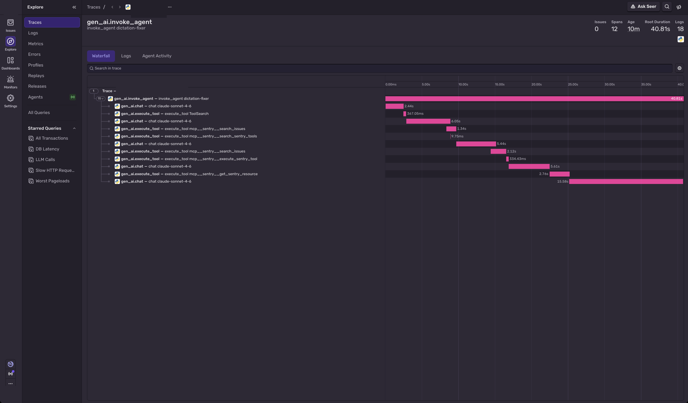
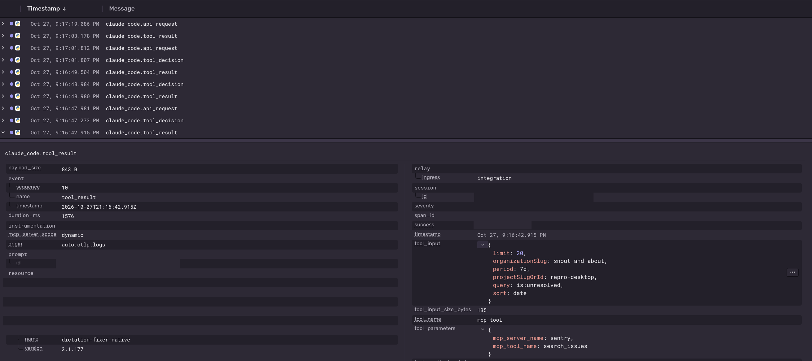

A simulated metric alert starts a headless Claude Code session. This demo does not claim the diagnosis is correct. The agent reads whatever organization and project you set, and there is no baked-in answer.

Two ways to get that session into Sentry's Agents > Conversations view. Option A is the one to copy.

## Option A: collector (recommended)

An OpenTelemetry Collector sits between Claude Code and Sentry. Claude's own telemetry stays in its process. The collector renames `claude_code.interaction`, `claude_code.llm_request`, and `claude_code.tool` into the `gen_ai` spans Conversations renders. Nothing in the agent loop imports `tracing.py`.

The config to run is `collector/otelcol.customer.yaml`. It does not write a file. It drops the `tool.execution` and `tool.blocked_on_user` child spans, fills a missing cache count with 0, and deletes the user and organization attributes. `collector/otelcol.yaml` is the experiment config: same mapping, plus a file exporter and a prompt mapping. Tested with Claude Code 2.1.177 and `otelcol-contrib` 0.163.2.

### Quickstart

1. Get the collector binary. This machine used the darwin arm64 0.163.2 release. The tarball's sha256 is `ae0dff18926bc3f1e3ef4d1633c4ad4326781f302da2ba5be2ce215ba86e4b9e`. Do not commit the binary.

   ```bash
   curl -fsSL -o /tmp/otelcol-contrib.tar.gz \
     https://github.com/open-telemetry/opentelemetry-collector-releases/releases/download/v0.163.2/otelcol-contrib_0.163.2_darwin_arm64.tar.gz
   shasum -a 256 /tmp/otelcol-contrib.tar.gz
   mkdir -p /tmp/df-collector && tar -xzf /tmp/otelcol-contrib.tar.gz -C /tmp/df-collector
   ```

   On another OS, use that platform's `otelcol-contrib` 0.163.2 asset from the same release, and check its `.sha256`.

2. Put the endpoints and the public DSN key in the environment. `AGENT_NAME` is required. The YAML adds the `sentry sentry_key=` prefix, so the variable is the key alone. Single-quote it. An unquoted `sentry sentry_key=...` value is truncated by the shell to the word `sentry`, and Sentry returns 401.

   The endpoint host and project id are the ones in your DSN. A DSN `https://KEY@oORG.ingest.REGION.sentry.io/PROJECT` uses `https://oORG.ingest.REGION.sentry.io/api/PROJECT/integration/otlp/v1/traces` and the same URL with `/logs`.

   ```bash
   export AGENT_NAME=dictation-fixer
   export SENTRY_OTLP_KEY='your-public-dsn-key'
   export SENTRY_OTLP_TRACES_ENDPOINT='https://oORG.ingest.REGION.sentry.io/api/PROJECT/integration/otlp/v1/traces'
   export SENTRY_OTLP_LOGS_ENDPOINT='https://oORG.ingest.REGION.sentry.io/api/PROJECT/integration/otlp/v1/logs'
   ```

   If `AGENT_NAME` is unset, the span name is the literal `AGENT_NAME is unset`.

3. Start the collector and leave it running:

   ```bash
   /tmp/df-collector/otelcol-contrib --config collector/otelcol.customer.yaml
   ```

   The tarball extracts the binary at the top of that directory. It listens on `127.0.0.1:4318`.

4. From the repo root, fill the prompt env and log Claude in once under this repo's config dir. A login in `~/.claude` is not visible here. `agent-home/` is gitignored. `claude auth login` is interactive; a fresh clone stops here until it finishes. If `run_native.py` then prints `is_error True` and the stream says `Not logged in · Please run /login`, that login was not done for `./agent-home`.

   ```bash
   cp .env.example .env
   # fill SENTRY_DSN, SENTRY_ORG, SENTRY_PROJECT, SENTRY_ACCESS_TOKEN
   CLAUDE_CONFIG_DIR=./agent-home claude auth login
   ```

   `collector/run_native.py` is the demo runner. It reads `.env`, sets the variables below, uses `./agent-home`, and does not import `tracing.py`. The collector itself does not read the DSN.

   ```bash
   export CLAUDE_CODE_ENABLE_TELEMETRY=1
   export CLAUDE_CODE_ENHANCED_TELEMETRY_BETA=1
   export OTEL_TRACES_EXPORTER=otlp
   export OTEL_LOGS_EXPORTER=otlp
   export OTEL_METRICS_EXPORTER=none
   export OTEL_EXPORTER_OTLP_PROTOCOL=http/protobuf
   export OTEL_EXPORTER_OTLP_ENDPOINT=http://127.0.0.1:4318
   export OTEL_TRACES_EXPORT_INTERVAL=1000
   export OTEL_LOGS_EXPORT_INTERVAL=1000
   python3 collector/run_native.py
   ```

   Leave `OTEL_LOG_USER_PROMPTS`, `OTEL_LOG_TOOL_DETAILS`, and `OTEL_LOG_TOOL_CONTENT` unset unless you want the log attributes in the next section. `run_native.py --content` sets all three.

5. In Sentry, open Traces and the new trace, or open Agents > Conversations and follow a trace link from the row. Give the index half a minute. The picture is that interaction trace, the whole tree, from a content-off run through `collector/otelcol.customer.yaml`. The header is 0 issues, 12 spans, root duration 40.81s, and 18 logs. The root is `gen_ai.invoke_agent`. Under it are `gen_ai.chat` and `gen_ai.execute_tool`. The customer config drops `tool.execution` and `tool.blocked_on_user`, so those children are not in the tree.



### What you see, and what you don't

With the collector, the conversation transcript does not carry the prompt, the assistant text, or the tool bodies. Those stay `<not reported>`, and tool rows stay `0 B`. For a transcript with the real prompt and the assistant text, use Option B.

Tool arguments are not on those spans. With `OTEL_LOG_TOOL_DETAILS=1` and `OTEL_LOG_TOOL_CONTENT=1` (`run_native.py --content` sets both, plus `OTEL_LOG_USER_PROMPTS`), the argument JSON is on the logs for that trace: `tool_parameters` on `claude_code.tool_decision`, and `tool_input` on `claude_code.tool_result`. The conversation page still does not render them. The picture is the log table for a content-on run through the same customer config, with one `claude_code.tool_result` open. `tool_input` is expanded and shows `limit`, `organizationSlug`, `projectSlugOrId`, `period`, `query`, and `sort`. `tool_parameters` on that same row shows `mcp_server_name` and `mcp_tool_name`. That run is a different process from the trace above, so the trace above does not have this JSON. There is no tool-result body and no assistant text in the logs either.



### Cost

Sentry prices the span token attributes at the 5-minute cache-write rate ($3.75 per million). The CLI's `result.total_cost_usd` matches `cost_usd` on the `claude_code.api_request` logs and uses the 1-hour cache-write rate ($6 per million). The conversation page does not show the CLI total. Read the CLI total, or sum `cost_usd` on the logs.

### Canary

`collector/canary.py` checks that a capture still has `span.type=interaction`, `span.type=llm_request`, and the four token attributes (`input_tokens`, `output_tokens`, `cache_read_tokens`, `cache_creation_tokens`). A Claude Code upgrade that renames them fails the script. It was run against Claude Code 2.1.177 and `otelcol-contrib` 0.163.2.

```bash
python3 collector/canary.py --capture DIR    # DIR/traces.json from the file exporter
python3 collector/canary.py --live
```

`--live` needs port 4318 free and a Claude login in `./agent-home`. It runs one trivial `claude -p` prompt through `collector/baseline.yaml` and does not export to Sentry. Set `OTELCOL` if the binary is not the path from step 1.

## Option B: wrapper (`tracing.py`)

Use this when the conversation page has to show the prompt, the tool arguments, and the tool results. `tracing.py` (471 lines) reads `claude`'s `stream-json` and emits `gen_ai.invoke_agent`, `gen_ai.chat`, and `gen_ai.execute_tool` through `sentry-sdk` 2.68.1. Native Claude telemetry is off in this path, so the same work is not recorded twice.

```bash
python3 -m venv .venv && .venv/bin/pip install -r requirements.txt
cp .env.example .env
# fill SENTRY_DSN, SENTRY_ORG, SENTRY_PROJECT, SENTRY_ACCESS_TOKEN
CLAUDE_CONFIG_DIR=./agent-home claude auth login
.venv/bin/python run.py
```

Leave `DICTATION_FIXER_CAPTURE_CONTENT` unset and the page shows names, durations, and tokens, with `<not reported>` bodies. Set it to `1` and the transcript carries the prompt, tool arguments, and tool results. The data scrubber on the dictation-fixer project did not remove file paths or organization slugs. Do not turn this on against a project whose scrubbing you have not checked.


That picture is one content-on run: 5 LLM calls, 0 errors, 68K, $0.0809. The 68K and $0.0809 are the stream's per-message counts. `result.usage` output on that run was 2,135, and the CLI total was $0.152. The page under-counts because the chat spans carry the stream's output count. The exact total is on `gen_ai.invoke_agent`. Haiku is an attribute on that span, not its own chat, so the page does not count it.


Durations in the wrapper are gaps between `stream-json` events (`timing=approximate_stream_arrival`), not the CLI's own span timestamps. `webhook.py` starts the same runner from a POST to `127.0.0.1:8787/metric-alert`. See the script for the signature check.

Sentry's OTLP intake accepts traces and logs. Metrics return 404, on both options. Cost on the page is Sentry's price for the token attributes, not Claude's cost metrics.
