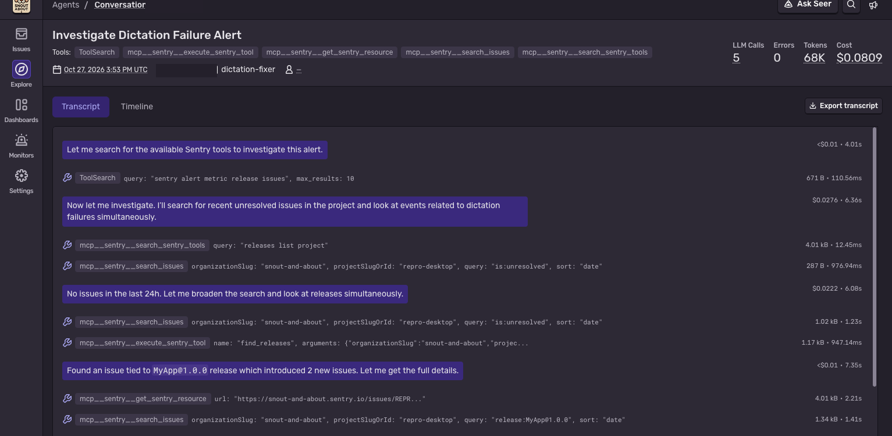
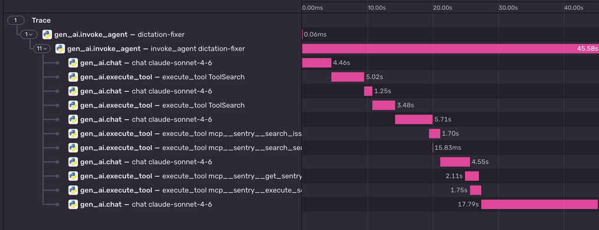

A simulated metric alert starts a headless Claude Code session. This process records that session as Sentry `gen_ai` spans. The alert is not registered with Sentry. Nothing here receives a real alert unless you POST one yourself.

The agent reads whatever organization and project you set. `SENTRY_ORG` and `SENTRY_PROJECT` go into the prompt, and a posted alert can name a different project. There is no baked-in answer. This demo does not claim the diagnosis is correct.

Native Claude telemetry stays off. Conversations fills in from this wrapper.

Tool and chat durations are the gaps between `stream-json` events arriving here. They are tagged `timing=approximate_stream_arrival`. That clock is not `claude_code.tool.execution`. There is one `gen_ai.chat` per assistant response id. A tool result does not close it. It closes when a different id arrives, or at `result`. The first chat opens before the CLI starts, so it includes CLI and MCP startup. The conversation picture is the run described in this section. The waterfall picture is an earlier content-off run. The timings are approximate.

## Quickstart

```bash
python3 -m venv .venv && .venv/bin/pip install -r requirements.txt
cp .env.example .env
# fill SENTRY_DSN, SENTRY_ORG, SENTRY_PROJECT, SENTRY_ACCESS_TOKEN
CLAUDE_CONFIG_DIR=./agent-home claude auth login
.venv/bin/python run.py
```

`python run.py` is the one-shot. It reads `.env`, uses `./agent-home` plus only `mcp.json`, and prints the session id and trace id. It does not query Sentry back.

Log in once with `CLAUDE_CONFIG_DIR` pointed at `./agent-home`. A login stored in `~/.claude` is not visible here. `agent-home/` is gitignored.

To start the same run from a simulated alert:

```bash
.venv/bin/python webhook.py
```

```bash
curl -X POST http://127.0.0.1:8787/metric-alert \
  -H 'content-type: application/json' \
  -d '{"action":"critical","data":{"metric_alert":{"projects":["your-project"],"alert_rule":{"name":"Simulated dictation failure rate"}}}}'
```

`webhook.py` listens on `127.0.0.1` and port `8787` (`PORT` overrides it). A body without `data.metric_alert` gets HTTP 400. A valid body gets HTTP 202 and a `run_id` immediately. The Claude session runs on a background thread.

`projects[0]` and `alert_rule.name` are the only payload fields copied into the prompt, and each is clipped (100 and 200 characters). The rest of the body is not inserted. If `projects[0]` is missing, the prompt uses `SENTRY_PROJECT`.

If `SENTRY_WEBHOOK_SECRET` is set, the request must send `Sentry-Hook-Signature`, the HMAC-SHA256 hex digest of the raw body (a `sha256=` prefix is accepted). A missing or wrong signature is HTTP 401. If the variable is unset, signatures are not checked.

## What the page shows

Content on. Approximate stream-arrival timing. Five assistant response ids, five `gen_ai.chat` spans, no duplicate id. The page's LLM call count is 5, the same as those ids. Haiku ran once and is not a span, so the page does not count it. Five ids plus Haiku is 6 model calls.



The transcript starts with the first assistant message, then `ToolSearch` and the Sentry MCP tools with their arguments, sizes, durations, and costs. The alert text is stored on `gen_ai.invoke_agent` as `gen_ai.input.messages`. This conversation page does not render that user message, so the picture starts at the assistant's first line. The crop stops above the final answer. That answer said a recent release caused the alert. The other runs on this prompt said the same thing, and this demo does not claim that is correct, so the answer is not in the picture. This picture shows 5 LLM calls, 0 errors, 68K tokens, and $0.0809. The 68K is the sum of the stream's per-message usage. Those five chats report 25 output tokens in all. `result.usage` output is 2,135, and that exact total is on `gen_ai.invoke_agent`, so the conversation summary under-counts output. Haiku is not a chat span, so the page does not count it. The CLI reported $0.152 for this run (8 turns, about 42s).

With content capture left off, the same page shows names, durations, and tokens, and the prompts and results read `<not reported>`.



Earlier content-off run, the whole tree, through the 17.79s chat. The top row, `gen_ai.invoke_agent` named `dictation-fixer`, is **0.06ms**. That span is closed before `claude` starts so Sentry will list the trace while `invoke_agent` is still open. It is not a model call. The long bar under it is `invoke_agent` (45.58s). The first `gen_ai.chat` is 4.46s and starts when the wrapper opens it, before the CLI and MCP are up, so that bar includes startup. Later chats stay open for the rest of the same response id, including across a tool result.

## Env vars

| Variable | What it does |
|---|---|
| `SENTRY_DSN` | Where the wrapper sends spans and logs. |
| `SENTRY_ORG` | Organization the prompt names. |
| `SENTRY_PROJECT` | Project the prompt names, unless the posted alert names one. The agent reads that project's telemetry through the MCP. |
| `SENTRY_ACCESS_TOKEN` | Token for the Sentry MCP server. Not the DSN. |
| `CLAUDE_MODEL` | Optional. Default `sonnet`. |
| `DICTATION_FIXER_CAPTURE_CONTENT` | Default off. Set to `1` to attach the prompt, the final answer, tool arguments, and tool results. |
| `DICTATION_FIXER_MAX_TURNS` | Optional. Passed to `--max-turns` when the webhook starts the run. Default 20. |
| `SENTRY_WEBHOOK_SECRET` | Optional. If set, `webhook.py` requires `Sentry-Hook-Signature`. |
| `PORT` | Webhook port. Default 8787. |

`python run.py --max-turns N` passes the CLI flag `--max-turns`. It does not set a `maxTurns` settings key.

`run.py` also sets `CLAUDE_CONFIG_DIR` to `./agent-home`, `CLAUDE_CODE_DISABLE_AUTO_MEMORY=1`, and turns Claude's own OTEL exporters off.

## Content capture

Leave `DICTATION_FIXER_CAPTURE_CONTENT` unset. Spans then carry names, durations, and token counts. The same page shows names, durations, and tokens, and the prompts and results read `<not reported>`. A tool row that shows **0 B** means that body was not stored. It does not mean the tool returned an empty result.

Setting it to `1` sends message and tool bodies. On the dictation-fixer project the data scrubber is on, with default scrubbers, and it still did not remove file paths or organization slugs. Do not turn this on against a project whose scrubbing you have not checked.

## What to change in your own loop

Keep the alert text your webhook already builds. Replace the body of `alert_prompt()` with that text. Keep the length limit if any of that text comes from the webhook body.

Spans are opened while `claude` is still running:

- A short segment span is closed immediately, then `gen_ai.invoke_agent` starts as its child.
- `system` / `init` `session_id` becomes `gen_ai.conversation.id`.
- The first `gen_ai.chat` opens before the process, so it includes CLI and MCP startup. One chat per assistant response id. A `tool_result` does not close it. A different id does, and so does `result`. A reused response id is logged. It does not stop the agent.
- A later chat has to start at the previous event. `sentry-sdk` 2.68.1 `traces.start_span()` has no `start_timestamp` argument, and `StreamedSpan.start_timestamp` is read-only. The older `Span` constructor accepts `start_timestamp`, but that API does not emit streamed spans when `trace_lifecycle="stream"`. The mapper sets `_start_timestamp` for that reason.
- `tool_use` opens `gen_ai.execute_tool`. The matching `tool_result` closes it.
- `result.usage` and `result.total_cost_usd` go on `gen_ai.invoke_agent`.
- Other models in `result.modelUsage` (Haiku) are attributes on that same span, `gen_ai.side_model.*`, with `timing=not_in_stream`. They are not their own chat span. The call is not in the stream, so a span for it would be 0ms.

`tracing.py` is the stream-json to `gen_ai` mapping (471 lines). `run.py` is the runner. `webhook.py` accepts the simulated alert. A telemetry failure is logged and does not stop the agent.

Logs use `sentry-sdk` with `enable_logs`. Inside the open invoke span the wrapper logs the run start, each tool failure, and a run summary. Those logs carry the same `trace_id`.

Point `mcp.json` at your MCP server. The runner passes `--strict-mcp-config` and `--setting-sources ""`, and the only built-in tool is `ToolSearch`.

## Native telemetry vs this wrapper

Claude can export `claude_code.interaction`, `claude_code.llm_request`, and `claude_code.tool` over OTLP. Sentry stores those spans with `span.op=default`. They do not set `gen_ai.operation.name` or `gen_ai.conversation.id`, so Conversations stays empty. A parent `invoke_agent` span plus `TRACEPARENT` nests the native tree in one trace, and Conversations still shows only the parent.

This wrapper emits `gen_ai.invoke_agent`, `gen_ai.chat`, and `gen_ai.execute_tool` through `sentry-sdk` 2.68.1 with `trace_lifecycle="stream"`. Native export is off, so the same work is not recorded twice and the standalone Haiku trace does not appear. Haiku's tokens from `result.modelUsage` are attributes on `invoke_agent`. This run did call Haiku. Its duration was not measured, and the conversation page does not count it as an LLM call.

`timing=approximate_stream_arrival` means the duration is how long this process waited between stream events.

## What Sentry cannot ingest

Sentry's OTLP endpoint accepts traces and logs. `POST .../v1/metrics` returns 404. Claude's `claude_code.cost.usage`, `claude_code.token.usage`, `claude_code.session.count`, and `claude_code.active_time.total` metrics have nowhere to go. Cost on these spans is Sentry's price for the token attributes, not those metrics.

## Token attributes

The CLI's `input_tokens` is the uncached count. Sentry prices `(input - cache read - cache write)` at the input rate, then adds cache read and cache write at their own rates. Copying the uncached count across next to those cache fields makes the cost negative. `usage_attributes()` sets `gen_ai.usage.input_tokens` to uncached + cache read + cache write. The alias fields are the same counts as `gen_ai.usage.cache_read.input_tokens` and `gen_ai.usage.cache_creation.input_tokens`. A one-trace check priced both layouts the same.

Sentry's cost is an estimate. For `claude-sonnet-4-6` it prices cache writes at the 5-minute rate, $3.75 per million tokens. These runs write a 1-hour cache (`ephemeral_1h`), which the CLI prices at $6 per million. Sentry can therefore under-report. On this run its price of the Sonnet tokens was $0.113 and `result.total_cost_usd` was $0.152. The real figure is `result.total_cost_usd` on the `gen_ai.invoke_agent` span (`gen_ai.usage.total_cost_usd`). The conversation summary sums the chat spans. It is not that figure. The page shows $0.0809 because those spans carry the stream's output count, 25 tokens, not the 2,135 on `result.usage`. A row that reads `<$0.01` is a positive cost under one cent. Haiku is not a chat span, so its cost is not in the summary.

Chat spans keep the output count from the stream. Several messages report 1 output token. On this run the five chats summed to 25 output tokens, and `result.usage` output was 2,135. That exact total is on `invoke_agent` only. Sonnet input on the chats matches `result.usage` (68,833, of which 51,484 are cache read and 17,338 are cache write). Haiku is 579 input and 19 output, on `gen_ai.side_model.*`, outside `result.usage`.
